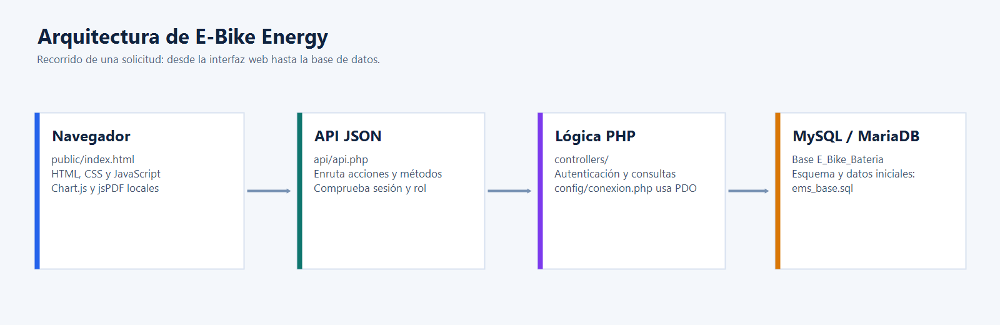
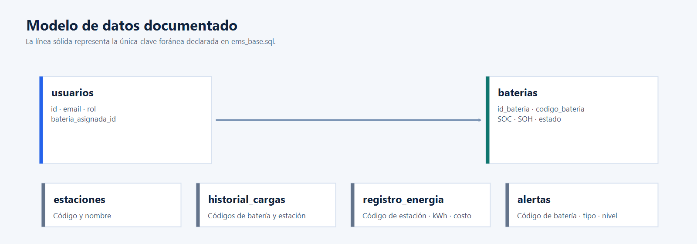

# Manual de instalación y técnico — E-Bike Energy

## 1. Arquitectura del proyecto

La aplicación usa PHP para el punto de entrada JSON y la lógica de negocio, JavaScript/HTML/CSS para la interfaz y PDO para acceder a MySQL/MariaDB.

El diagrama resume los componentes y el recorrido real de una solicitud en el repositorio:




### Estructura de carpetas

```text
api/api.php                         Enrutador JSON
config/conexion.php                 Configuración y conexión PDO
controllers/autenticacion.php       Sesión, roles y verificación de credenciales
controllers/operaciones.php         Consultas, resúmenes y reportes
controllers/registrobicicleta.php   Alta de baterías
public/index.html                   Aplicación de una página
public/css/index.css                Estilos
public/js/api.js                    Cliente de la API
public/js/ui.js                     Navegación y permisos de interfaz
public/js/main.js                   Carga de datos, gráficas y exportaciones
public/js/vendor/                   Chart.js, jsPDF, AutoTable y licencias
ems_base.sql                        Único script de esquema y datos iniciales
docs/                               Manuales Markdown y Word
skills/manuales/                    Reglas y conversor de documentación
README/                             Guía breve y prompt de mantenimiento
index.php                           Redirige a public/index.html
```

## 2. Requisitos de instalación

Se necesita un servidor web con PHP, extensiones `pdo_mysql`, `json` y `mbstring`, y MySQL o MariaDB con soporte para columnas generadas y procedimientos almacenados. XAMPP o Laragon pueden usarse como entornos locales Apache/PHP, pero el repositorio no fija versiones mínimas ni documenta una matriz de compatibilidad: [PENDIENTE DE CONFIRMACIÓN: versiones de PHP, MySQL/MariaDB y servidor web probadas y soportadas].

Las dependencias de navegador se distribuyen localmente en `public/js/vendor/`:

| Librería | Versión | Uso |
|---|---:|---|
| Chart.js | 4.4.7 | Gráficas en pantalla y gráficos incluidos en el PDF. |
| jsPDF | 4.2.1 | Creación del PDF en el navegador. |
| jsPDF-AutoTable | 5.0.9 | Tablas paginadas dentro del PDF. |

Los avisos de licencia están en `public/js/vendor/LICENSES.md`. El proyecto no necesita un CDN para esas tres librerías. Para regenerar Word se requiere Python y `python-docx` instalado en el entorno de ejecución.

## 3. Configuración y despliegue de la base de datos

1. Inicie Apache y MySQL/MariaDB desde XAMPP, Laragon u otro entorno compatible.
2. Importe el único archivo `ems_base.sql` en phpMyAdmin o mediante el cliente SQL. El script crea y selecciona `E_Bike_Bateria`, tablas, datos de ejemplo y procedimientos almacenados.
3. Revise `config/conexion.php`. Actualmente define host `localhost`, base `E_Bike_Bateria`, usuario `root` y contraseña vacía.
4. Coloque el proyecto bajo la raíz del servidor. En esta instalación, `index.php` redirige a `public/index.html`; la ruta local de ejemplo es `http://localhost/ebike_energia/`.

Credenciales iniciales de demostración declaradas en SQL e interfaz:

- Administrador: `admin@ebike.com` / `admin123`
- Cliente: `cliente@ebike.com` / `cliente123`

El primer acceso válido convierte una contraseña demo heredada en texto plano a un hash. Estas credenciales no son apropiadas para producción; el repositorio no incluye una pantalla de cambio de contraseña ni una configuración de secretos externa: [PENDIENTE DE CONFIRMACIÓN: procedimiento de provisión y rotación de credenciales para producción].

### Esquema, campos y relaciones

| Tabla | Columnas principales |
|---|---|
| `estaciones` | `id_estacion`, `codigo_estacion`, `nombre`. Incluye cuatro estaciones de ejemplo. |
| `baterias` | `id_bateria`, `codigo_bateria`, `codigo_bicicleta`, `codigo_qr`, `capacidad_wh`, `fecha_instalacion`, `nivel_carga`, `soh`, `temperatura`, `vida_util`, `estado`. |
| `usuarios` | `id`, `nombre`, `email`, `password`, `rol`, `bateria_asignada_id`, `creado_en`. Roles SQL: `administrador` y `cliente`. |
| `historial_cargas` | `id_historial`, `codigo_bateria`, `codigo_estacion`, `porcentaje_inicial`, `porcentaje_final`, `energia_consumida`, `tiempo_carga`, `estado_carga`, `fecha_carga`. |
| `registro_energia` | `id_registro`, `codigo_estacion`, `cantidad_kwh`, `costo_kwh`, `total_costo`, `tipo_operac`, `fecha_registro`. `total_costo` es una columna generada como `cantidad_kwh * costo_kwh`. |
| `alertas` | `id_alerta`, `codigo_bateria`, `tipo_alerta`, `nivel_riesgo`, `mensaje`, `estado`, `fecha_alerta`. |

La única clave foránea declarada es `usuarios.bateria_asignada_id → baterias.id_bateria`, con `ON DELETE SET NULL` y `ON UPDATE CASCADE`. Las referencias de batería y estación en cargas, energía y alertas son códigos de texto; el SQL no define claves foráneas para ellas.



Procedimientos almacenados requeridos por los reportes:

- `sp_reporte_consumo_estaciones(p_inicio, p_fin)`
- `sp_reporte_alertas_seguridad(p_nivel)`
- `sp_reporte_estado_flota()`
- `sp_reporte_sesiones_carga(p_estado)`

## 4. API y permisos

La API devuelve JSON en `api/api.php`. Las acciones se envían como `?action=...`. Para acciones administrativas, el servidor devuelve 401 sin sesión y 403 con un rol distinto de administrador, salvo las rutas de acceso cliente que aplican su comprobación específica.

| Acción | Método | Acceso | Resultado o limitación actual |
|---|---|---|---|
| `sesion_actual` | GET | Público | Estado de sesión, nombre y rol. |
| `login` | POST | Público | Recibe correo y contraseña; credenciales incorrectas devuelven 401. |
| `cerrar_sesion` | POST | Público | Limpia datos de sesión y expira la cookie. |
| `bateria_cliente` | GET | Cliente autenticado | Batería asociada, SOC, SOH, temperatura, estado y autonomía estimada. |
| `resumen` | GET | Administrador | Conteos por SOC, SOC promedio y conteo de estaciones/flota. |
| `datos_formulario_bateria` | GET | Administrador | Siguiente código y códigos de bicicleta asociados a baterías. |
| `listar_baterias` (alias `baterias` o acción vacía) | GET | Administrador | Inventario con campos disponibles, incluido SOH. |
| `guardar_bateria` | POST | Administrador | Persiste código, bicicleta, SOC, temperatura fija, estado y fecha. El endpoint no persiste QR ni SOH enviados por el formulario. |
| `listar_cargas` (alias `historial_cargas`, `cargas`) | GET | Administrador | Consulta el historial. No hay acción de creación de sesiones. |
| `registrar_energia` | POST | Administrador | El código del manejador valida estación, consumo, tarifa y detalle, pero el enrutador procesa los POST antes y solo admite `guardar_bateria`; la solicitud actual termina en 404 y no alcanza este manejador. |
| `obtener_registro_energia` | GET | Administrador | Libro de registros. |
| `obtener_alertas` | GET | Administrador | Hasta 100 alertas recientes. |
| `reporte_consumo` | GET | Administrador | Opcionales `inicio` y `fin`, formato `YYYY-MM-DD`, fechas válidas y ordenadas. |
| `reporte_alertas` | GET | Administrador | Filtro opcional `nivel`: `INFORMACION`, `ADVERTENCIA` o `CRITICA`. |
| `reporte_estado_flota` | GET | Administrador | Agrupa baterías por estado. |
| `reporte_sesiones_carga` | GET | Administrador | Filtro opcional por estado de carga. |

Los filtros de reportes están disponibles en la API; la pantalla actual no muestra controles de fecha, nivel o estado. No hay endpoints de administración de estaciones, edición o eliminación de registros, alta de usuarios, ni alta funcional de sesiones de carga.

## 5. Seguridad y control de acceso

- `autenticacion.php` inicia sesión PHP y, al autenticar, llama a `session_regenerate_id(true)` antes de guardar el ID, nombre y rol.
- `api.php` valida el rol en servidor. La navegación y los elementos `.admin-only`/`data-role-required` también se filtran en la interfaz, pero esa ocultación no sustituye el control de servidor.
- Las contraseñas se comprueban con `password_verify()`. Una contraseña heredada que coincida en texto plano se actualiza con `password_hash(..., PASSWORD_DEFAULT)` tras el primer acceso válido.
- Las consultas con parámetros externos usan sentencias preparadas PDO. `obtenerColumnasTabla()` aplica una lista permitida de nombres de tabla antes de construir consultas de inspección.
- La conexión y las credenciales residen directamente en `config/conexion.php`; no hay `.env` implementado.

## 6. Generación del PDF consolidado

El botón consulta en paralelo cinco acciones con la sesión actual: `reporte_consumo`, `reporte_sesiones_carga`, `reporte_estado_flota`, `reporte_alertas` y `listar_baterias`. Cada módulo obtiene sus propias metas (o la indicación de que no están configuradas), avances calculados, recomendaciones, gráfica temporal y tabla. La generación no cambia el reporte seleccionado ni el gráfico visible.

En consumo suma kWh, COP y cantidad de registros, y añade a cada estación su participación en el consumo total. Las sesiones calculan variación de SOC, duración media y distribución de estados. El módulo de inventario presenta SOH disponible. No se inventan presupuestos, umbrales de SOH ni causas de fallas que no estén en el esquema.

## 7. Limitaciones y pendientes de confirmación

- [PENDIENTE DE CONFIRMACIÓN: versión mínima de PHP y matriz de versiones probadas para MySQL/MariaDB y Apache].
- [PENDIENTE DE CONFIRMACIÓN: decidir si se implementará un rol operador y su matriz de permisos].
- [PENDIENTE DE CONFIRMACIÓN: corregir el enrutamiento de `registrar_energia` y conectar el formulario de sesiones de carga].
- [PENDIENTE DE CONFIRMACIÓN: guardar QR/SOH desde el alta de batería o ajustar el formulario].
- [PENDIENTE DE CONFIRMACIÓN: reemplazar KPI/gráficas HTML de muestra por datos del servidor y definir umbrales operativos].
- [PENDIENTE DE CONFIRMACIÓN: política de copias de seguridad y recuperación en producción].
