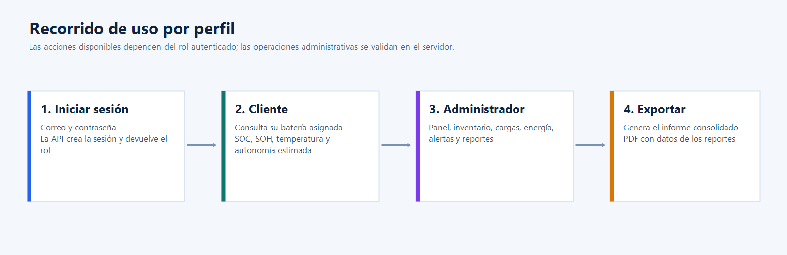

# Manual de usuario por roles — E-Bike Energy

## 1. Propósito

E-Bike Energy es una aplicación web para consultar la batería asociada a una cuenta cliente y, para administración, revisar el inventario, el historial de cargas, los registros de energía, las alertas y los reportes de la flota. La información persistida está en la base `E_Bike_Bateria`.

Este manual describe los controles presentes y el comportamiento conectado en el código. Cuando una pantalla existe pero no guarda cambios en el servidor, se indica de forma explícita.

## 2. Acceso, roles y permisos

Inicie sesión con el correo y la contraseña de su cuenta. La sesión se inicia desde la pantalla de acceso. Para salir, use **Cerrar sesión**; para cambiar de cuenta, use **Cambiar**.

| Perfil | Puede consultar | Puede crear | Editar o eliminar |
|---|---|---|---|
| Cliente (`cliente`) | Mi vehículo y los datos de la batería vinculada a su cuenta. | Nada desde la interfaz. | No disponible. |
| Administrador (`administrador`) | Panel, inventario, historial de cargas, energía, alertas e informes. | El endpoint de baterías guarda código, bicicleta y SOC. El formulario de energía intenta registrar un consumo, pero su acción no alcanza el manejador de guardado actual; ver pendiente en la sección 6. | No hay acciones de edición o eliminación expuestas por la API para estos módulos. |
| Operador | [PENDIENTE DE CONFIRMACIÓN: el rol `operador` no existe en el ENUM `usuarios.rol` ni en las comprobaciones de sesión.] | No disponible. | No disponible. |

El menú oculta las secciones administrativas a clientes y la navegación devuelve a **Mi vehículo** si se solicita una sección protegida. La API vuelve a comprobar el rol en el servidor; ocultar un botón por sí solo no concede acceso.

## 3. Guía paso a paso: Mi vehículo

1. Inicie sesión con una cuenta de cliente.
2. Abra **Mi vehículo** en el menú. Esta es la única sección operativa habilitada para este perfil.
3. Consulte el SOC, el código de batería, el estado, el SOH y la temperatura cuando estén disponibles.
4. La autonomía mostrada se estima en el servidor como `SOC × 0,4 km`; no es una medición directa de distancia restante.

Si no aparece una batería, la cuenta no tiene una batería vinculada en `usuarios.bateria_asignada_id`.

## 4. Guía del panel de administración

### 4.1 Panel general y reportes

Tras iniciar sesión como administrador, el panel general presenta métricas y una sección de reportes.

- La API actualiza el conteo de baterías según SOC, el SOC promedio y el conteo de estaciones. El cálculo considera críticas las baterías con SOC ≤ 20 para ese resumen.
- Algunos elementos del panel —por ejemplo, energía de 24 horas, alertas resumidas y gráficas decorativas— están escritos como valores de ejemplo en `public/index.html`; no los interprete como lecturas actuales del servidor.
- En la sección de reportes, elija **Consumo por Estación**, **Alertas de Seguridad**, **Estado de la Flota** o **Sesiones de Carga**. La gráfica y las tarjetas **Total de registros** y **Métrica destacada** cambian con los datos del reporte.
- El botón **Descargar informe consolidado PDF** genera un documento con cinco módulos: consumo, sesiones, estado de flota, alertas e inventario/SOH. No depende de cuál de los cuatro reportes esté seleccionado en pantalla.

El PDF contiene metas (o indica que no están configuradas), avances calculados desde las respuestas actuales, acciones de mejora, una gráfica y una tabla por módulo. En consumo muestra energía, costos COP y participación porcentual por estación. En sesiones resume variación media del SOC, duración media y conteos por estado. No hay umbrales de presupuesto o SOH configurados en la base.

### 4.2 Inventario y telemetría de baterías

1. Abra **Baterías** para consultar código, bicicleta, QR, SOC, SOH, temperatura, vida útil y estado.
2. Use **Buscar por código...** para filtrar la tabla en pantalla.
3. **Registrar batería** abre un formulario con código, bicicleta, QR, SOC y SOH.
4. Al guardar, el servidor persiste el código, la bicicleta, el SOC, temperatura inicial de 25 °C, estado `Operativa` y fecha de instalación.

El formulario envía QR y SOH, pero el controlador actual no los inserta en la base. No confíe en esos dos valores como persistidos: [PENDIENTE DE CONFIRMACIÓN: conectar el guardado de `codigo_qr` y `soh` o retirar esos campos del formulario].

### 4.3 Historial de cargas

Abra **Cargas** para consultar sesiones con batería, estación, SOC inicial/final, duración, estado y energía. La pantalla incluye **Nueva carga**, pero el formulario apunta a `mainController.guardarCarga(event)` y `api/api.php` no tiene una acción de guardado de sesiones. [PENDIENTE DE CONFIRMACIÓN: implementar y conectar el registro de nuevas cargas antes de ofrecerlo como función operativa.]

### 4.4 Energía y costos

**Descargar balance** exporta el libro de energía disponible en CSV. La pantalla también muestra **Nuevo Registro** con estación, consumo, tarifa y periodo/detalle. El JavaScript envía `POST action=registrar_energia`, pero el bloque inicial de enrutamiento POST solo admite `guardar_bateria`; por ello esa solicitud no llega al manejador de energía. [PENDIENTE DE CONFIRMACIÓN: corregir el orden del enrutador para habilitar el guardado de energía].

La tabla y el simulador contienen datos o valores de muestra en HTML; no todos los KPI del área energética se alimentan de la API.

### 4.5 Alertas

Abra **Alertas** para consultar las últimas 100 alertas en orden descendente por fecha. El reporte incluye batería, tipo, nivel de riesgo, mensaje y fecha. El código actual no ofrece una acción de la interfaz para resolver alertas.

### 4.6 Estaciones y filtros

Las estaciones se cargan desde `ems_base.sql` y se eligen al registrar energía; no existe una pantalla o API para crear, editar o eliminar estaciones. Los reportes aceptan filtros de fecha, nivel o estado en la API, pero la interfaz actual no muestra controles para esos filtros.

## 5. Acciones comunes

- **Sincronizar** vuelve a solicitar los datos conectados al servidor.
- **Modo visual** alterna la apariencia visual.
- **Cerrar sesión** termina la sesión activa.

## 6. Solución de problemas y pendientes

- **Credenciales rechazadas:** compruebe el correo y la contraseña; los errores de acceso no revelan si falló el correo o la contraseña.
- **No aparece la batería del cliente:** confirme la relación `bateria_asignada_id` de su usuario.
- **No se guarda una sesión o registro de energía:** las acciones de guardado indicadas como pendientes no están conectadas correctamente al enrutador actual.
- **No se actualiza un valor del panel:** verifique primero si el elemento es una métrica conectada o un valor ilustrativo estático, según la sección 4.1.

